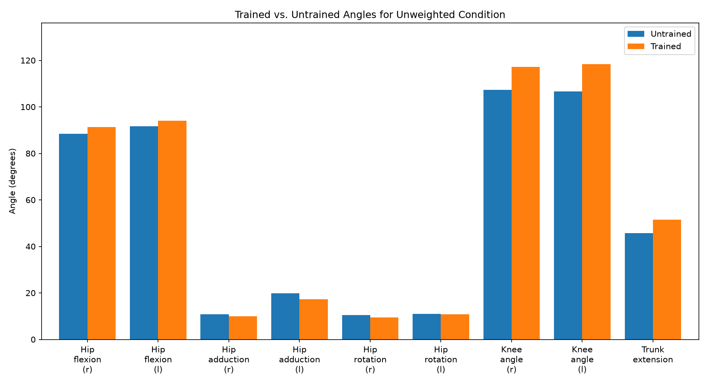
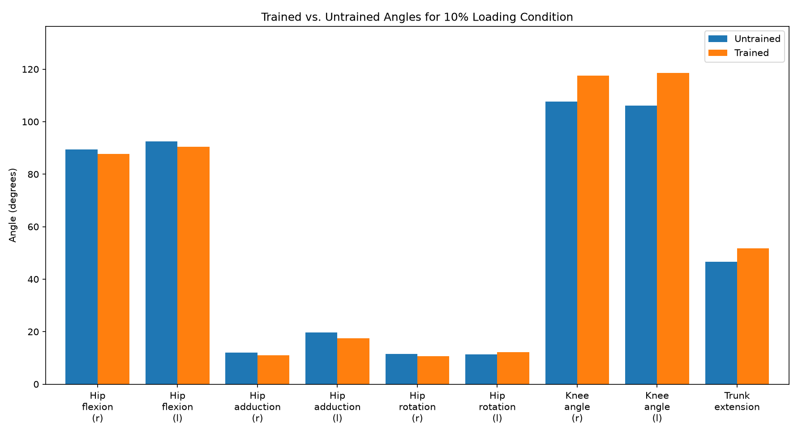
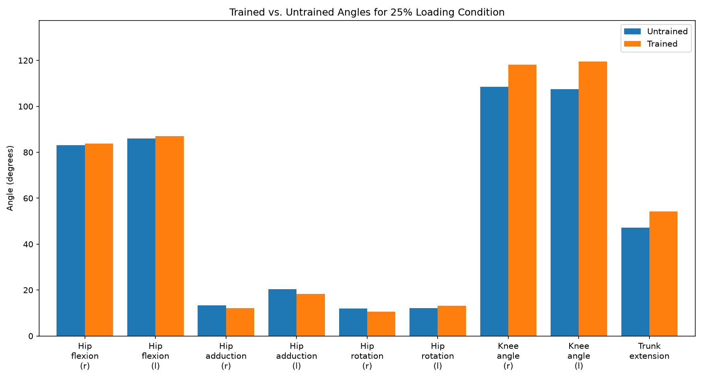

## Predictions
Participants were grouped as "trained" or "untrained" based on the level of formal squat form coaching that they have received. Between the two groups of more experienced and less experienced participants, we expected to see differences in the hip rotation angle and hip adduction angle. Lorenzetti et al. found that these two angles change based on foot angle and stance width, something that we expected trained squatters to do differently than untrained squatters. 

## Results
The following data was found between participants, comparing the average angle maximum or minimums between trained and untrained participants for each of the 3 weight conditions. 

## Discussion 

Based on a two-sided t-test, none of the p-values between trained and untrained participants were found to be statistically significant. Visually, the greatest difference between trained and untrained participants is seen for the knee angles, with trained participants tending to squat lower than untrained participants. There was also a difference seen for the trunk extension, with trained participants generally experiencing greater extension angles. P-values for the differences in knee angles tended to be between 0.1 and 0.2 and p-values for the differences in trunk extension tended to be between 0.2 and 0.4, so not statistically significant despite the visual difference. In general, there was very little difference between the shape of the graphs for the different loading conditions; the relationship stays approximately the same.

We hypothesize that the p-values are this large due to high standard deviations, as we saw a wide range of angles for both trained and untrained participants. We will continue to investigate this.

These comparisons contradict our hypothesis that there would primarily be a difference in the hip rotation angle and the hip adduction angle. Part of this result could be due to the fact that the coaching the trained participants received was not in a professional setting; rather most received general coaching for their sports. All of our participants were college-aged students so this could impact the similarity between trained and untrained groups. As a result, this study is limited in its capacity to measure the effect of coaching on squatting form. Future studies could expand on this by comparing between novice squatters and professionals such as bodybuilders.
