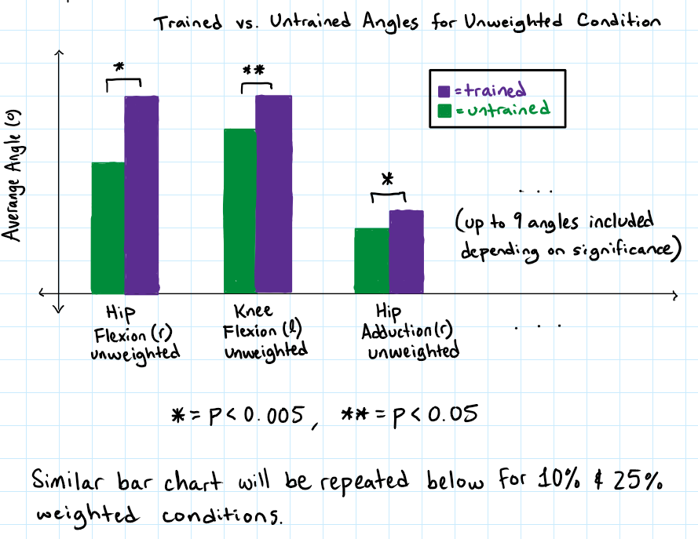

## Predictions
Participants were grouped as "trained" or "untrained" based on the level of formal squat form coaching that they have received. Between the two groups of more experienced and less experienced participants, we expected to see differences in the hip external/internal angle and hip abduction/adduction angle. Lorenzetti et al. found that these two angles change based on foot angle and stance width, something that we expected trained squatters to do differently than untrained squatters. 

## Results
The following data was found between participants. 

We are comparing the average angle maximum or minimums between trained and untrained participants for each of the 3 weight conditions. We will present this information as 3 sets of bar graphs (one for each weight condition) as pictured below. Each bar graph set will include the angles that have been determined to be statistically significant based on a two-sided t-test.

 

## Discussion
- Key p-values shown above
- what this means for our hypotheseis
- are squatter groups actually different? 

