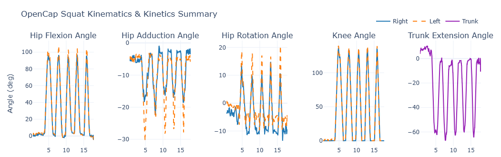
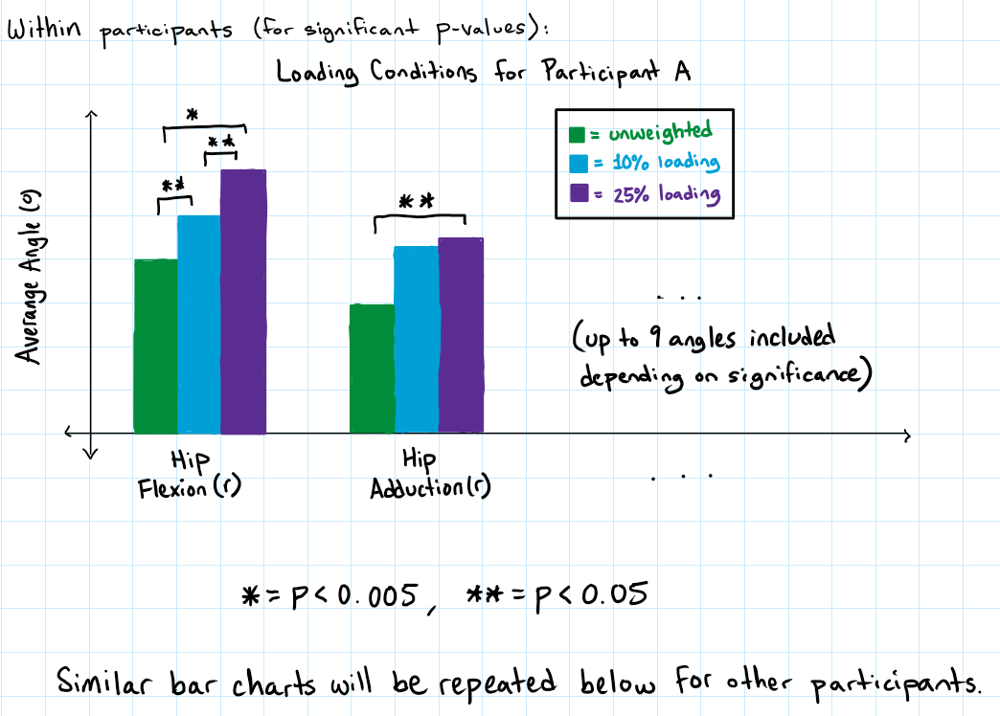

Within participants, as load is added, we expected to see improper form through an increase in knee valgus angle/hip adduction angle and trunk flexion. We anticipated that there could be multiple types of improper form. If the participant didn’t squat as low as is optimal or leaned forward excessively, we expected a decrease in knee flexion angles and an increase in hip flexion angles. If the participant squatted lower than optimal, we expected an increase in knee flexion angles and a decrease in hip flexion angles. 

## Results
For each participant, we extracted the following angles:

- Hip flexion (maximum values)
- Hip adduction (minimum values)
- Hip rotation (maximum values)
- Knee angle (maximum values)
- Trunk extension (minimum values)

Here is an example of what one set of squats would look like for each participant:

 

The angles of interest for hip adduction and trunk extension are reported as negative values for the squats over time, but to normalize our data, we have used the absolute value of each these minimums. Therefore, all future data presents these as positive values.

The following data was found within participants. 

We are comparing the average angle maximum or minimums across 3 loading conditions within participants. We will present this information as a set of bar graphs for each participant within statistically significant differences between loading conditions as pictured below. Each bar graph set will include the angles that have been determined to be statistically significant based on a two-sided t-test.

We will also include a table of the angles and p-values as another way to group this data more comprehensively.

## Discussion
- Key p-values shown above
- what this means for our hypotheseis
- does form actually change with added load? if so, in which ways?