Within participants, as load is added, we expected to see improper form through an increase in knee valgus angle/hip adduction angle and trunk extension. We anticipated that there could be multiple types of improper form. If the participant didn’t squat as low as is optimal or leaned forward excessively, we expected a decrease in knee flexion angles and an increase in hip flexion angles. If the participant squatted lower than optimal, we expected an increase in knee flexion angles and a decrease in hip flexion angles. 

## Results
For each participant, we extracted the following angles:

- Hip flexion (maximum values)
- Hip adduction (minimum values)
- Hip rotation (maximum values)
- Knee angle (maximum values)
- Trunk extension (minimum values)

Here is an example of what one set of squats would look like for each participant:

 

The angles of interest for hip adduction and trunk extension are reported as negative values for the squats over time, but to normalize our data, we have used the absolute value of each these minimums. Therefore, all future data presents these as positive values.

The following data was found comparing the average angle maximum or minimums across 3 loading conditions within participants. 

For each participant with statistically significant differences between loading conditions, the statistically significant angles are pictured below in a bar chart.

### Participant A
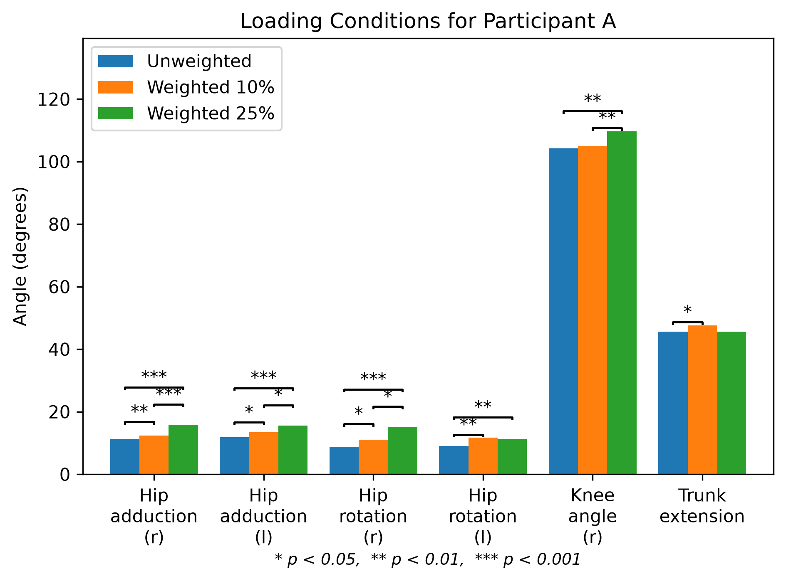

### Participant B
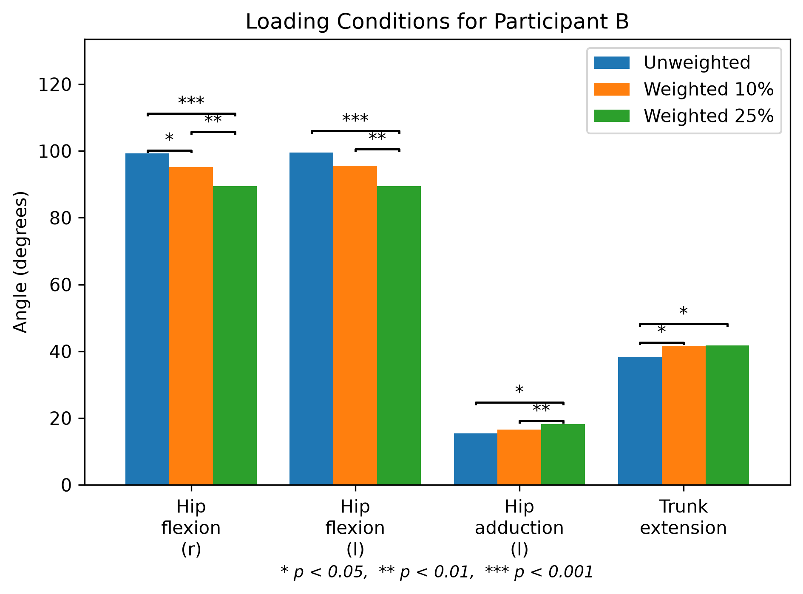

### Participant C
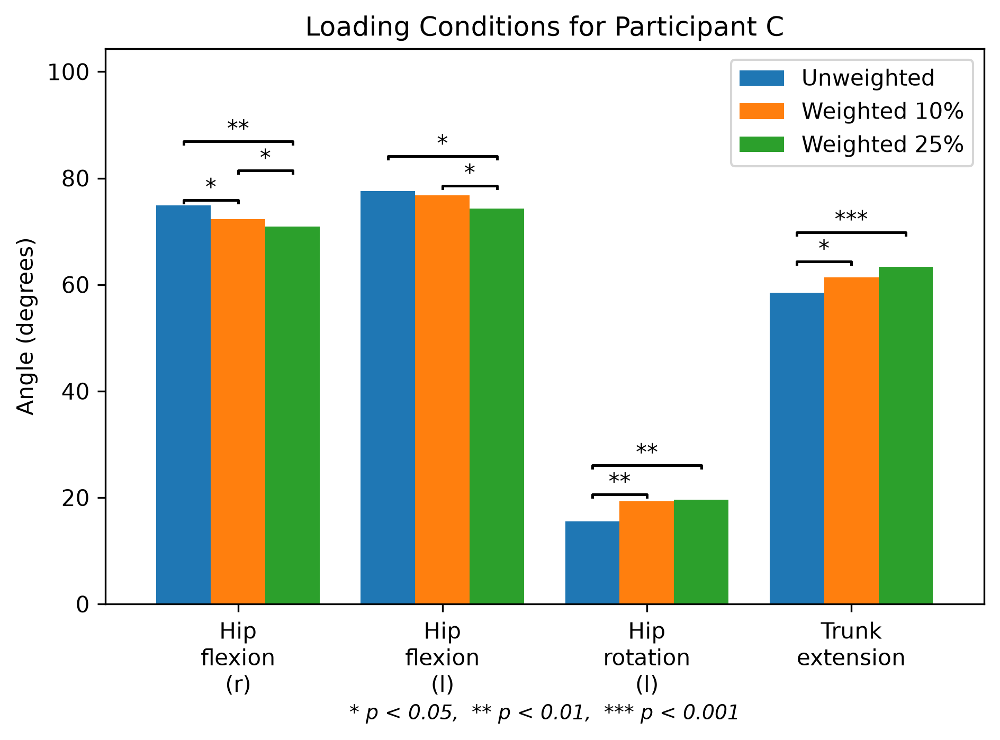

### Participant D
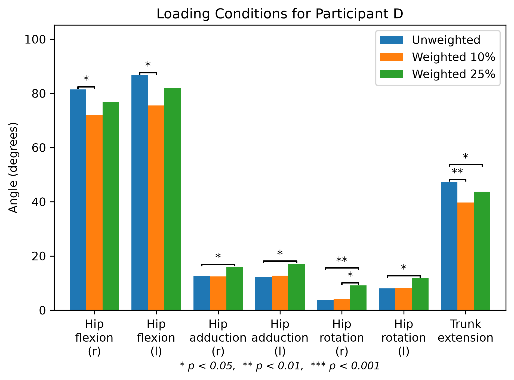

### Participant E
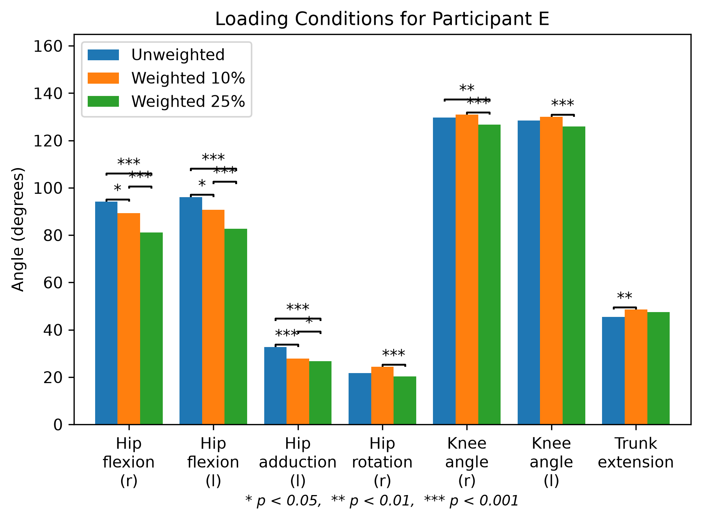

### Participant F
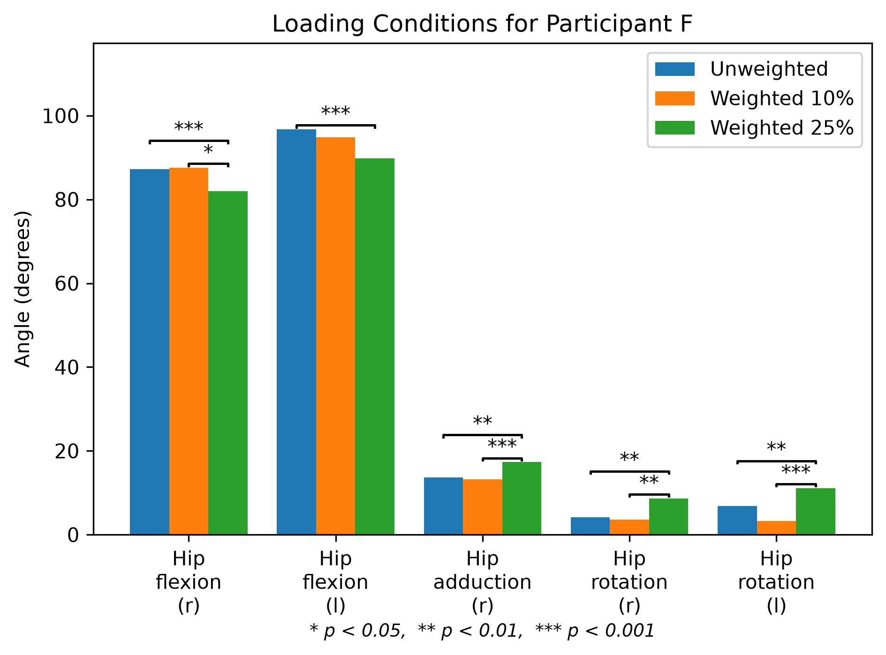

### Participant G
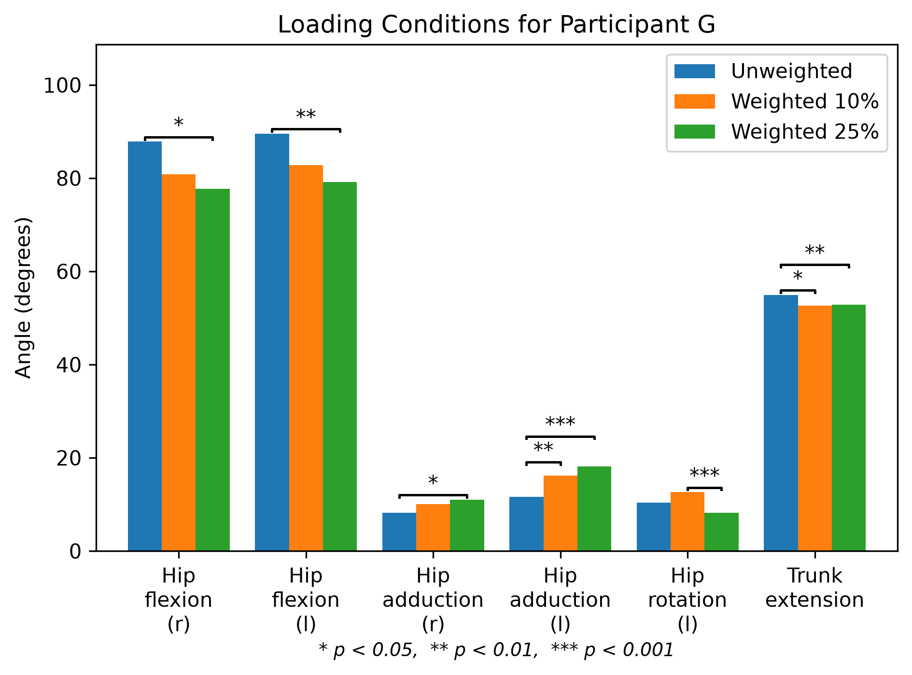

### Participant H
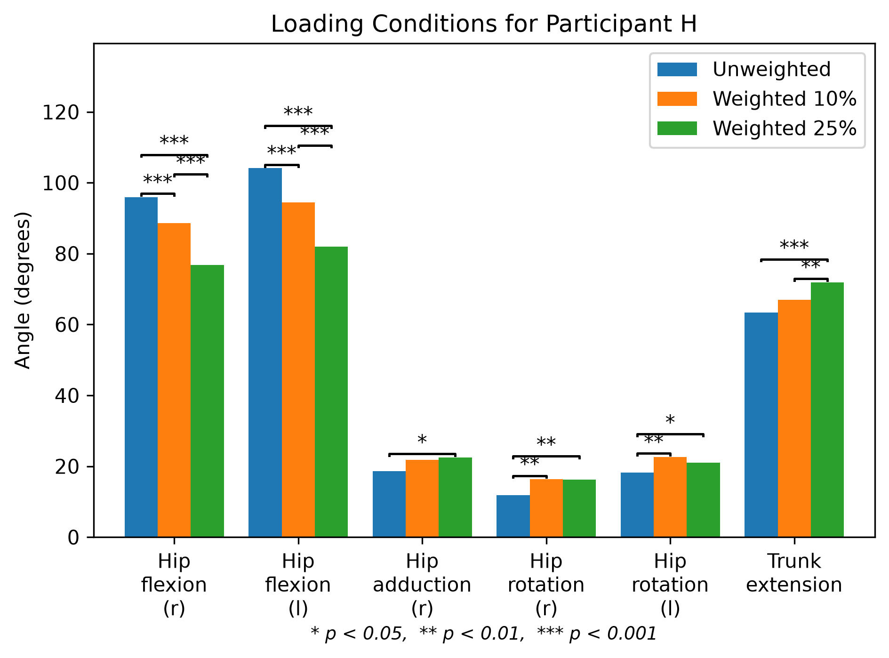

### Participant I
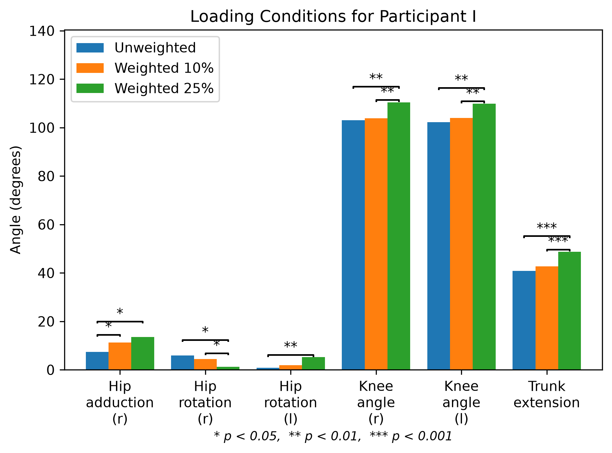

### Participant J
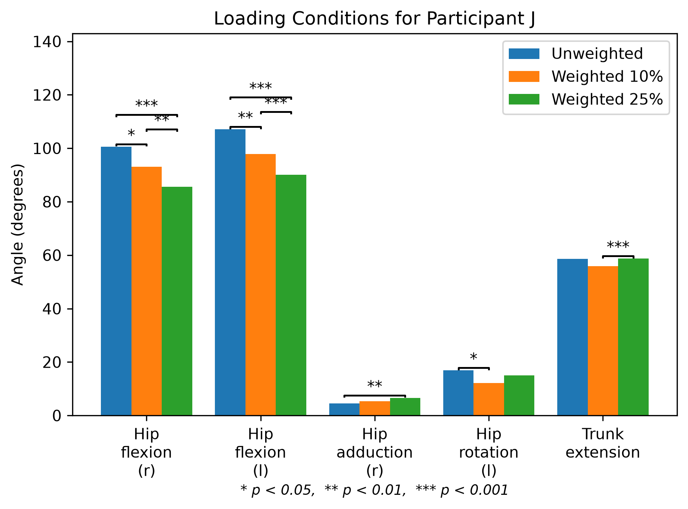

### Participant K
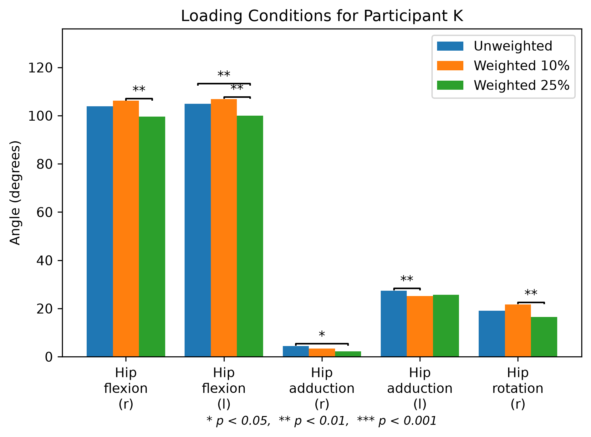

### Participant L
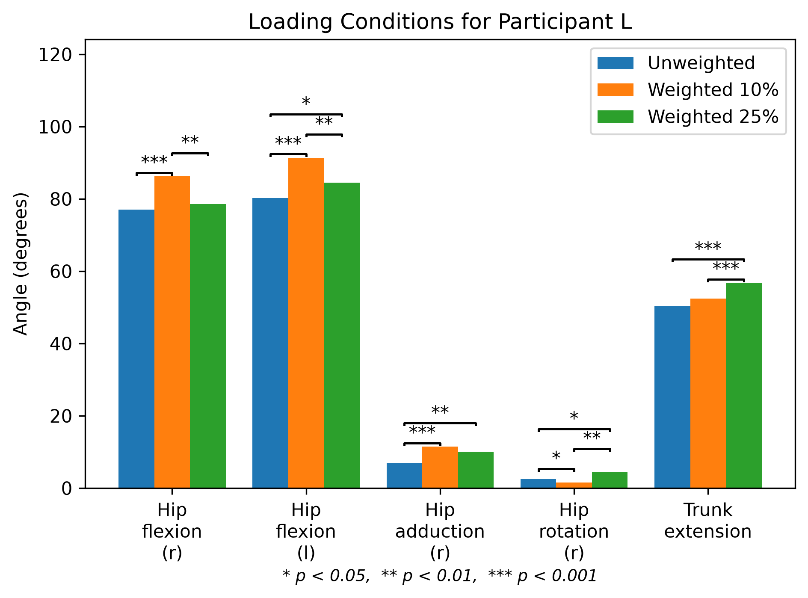

### Participant M
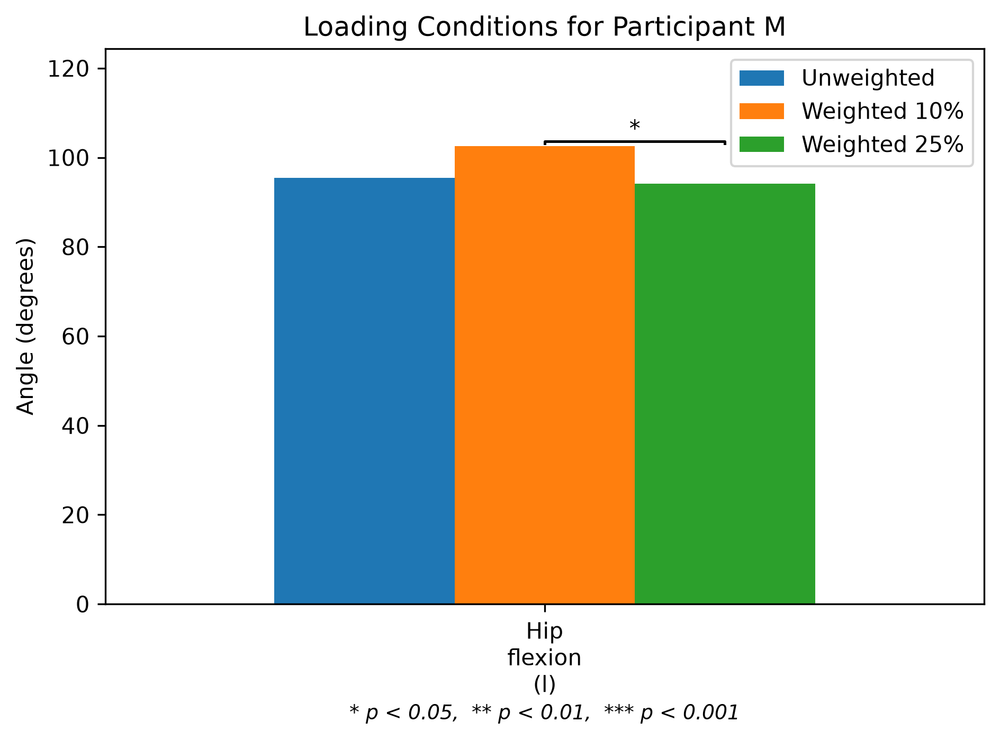

### Participant N
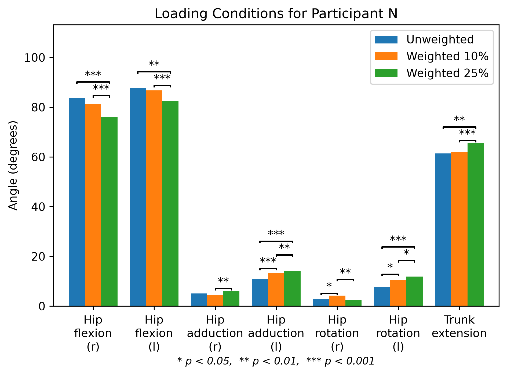

As we continue our data analysis, we will also include a table of the angles and p-values as another way to group this data more comprehensively.

## Discussion

Based on a one-way ANOVA and 3 pairs of two-sided t-tests, adjusted using the Bonferroni correction, every participant had at least one angle that showed a statistically significant change between loading conditions. Across several participants, there is a decrease in hip flexion angle as the weight increases (i.e. participants tend to lean less far forward). Additionally, many participants showed increased hip adduction (hip angling inward) over increased loading. For half of the participants, trunk extension increased over loading. 

These results tentatively confirm our hypothesis. The hip adduction angle, as a proxy for knee valgus angle, showed an increase as weight increases, which matches our expectation of a worsening squat form over time. Trunk extension follows the same pattern. The decrease in hip flexion that we noticed matches our expectation for participants squatting lower than optimal as heavier weight is added. We will continue this analysis to better quantify results. 