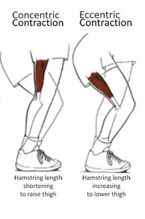
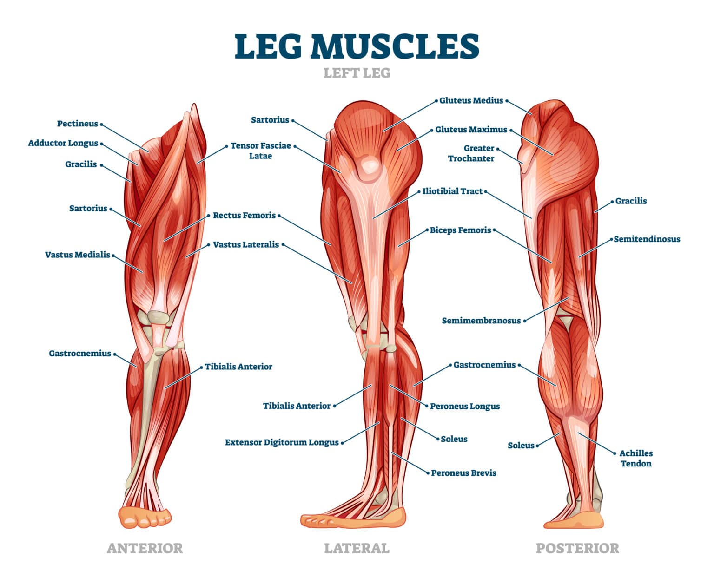
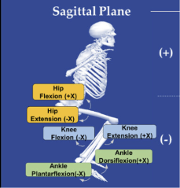
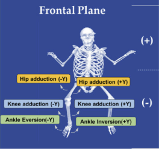
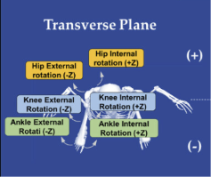
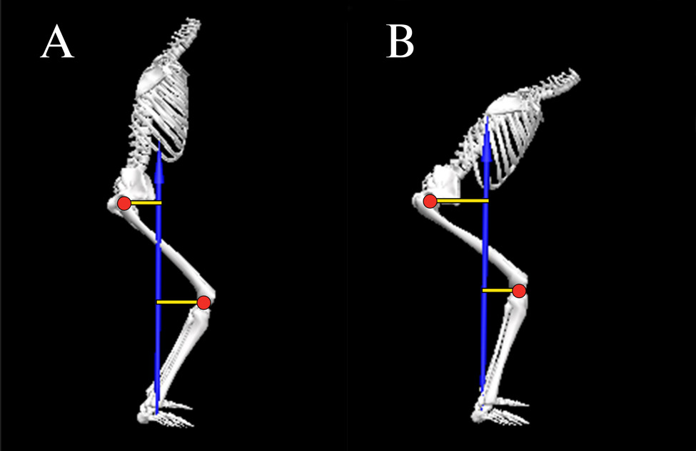

## Relevant Biology
Squatting is a movement that involves bending the knees while keeping the feet approximately shoulder-width apart and lowering until the knees reach approximately 90 degrees, then reversing this motion back to an upright position. 

::: {style="text-align: center;"}

:::

This movement involves many of the lower body muscles and joints. During the descent of a squat, the muscles involved contract eccentrically, the hip and knee joints flex, and the ankles dorsiflex (Sutton, 2021). During the ascent of a squat, the muscles involved contract concentrically, the hip and knee joints extend, and the ankles plantarflex (Sutton, 2021). Concentric contraction means that the muscle shortens to produce a force while eccentric contraction means that the muscle lengthens while maintaining a load, as shown the image below. 

{fig-alt="Image showing how the leg muscle concentrically contracts and eccentrically contracts during a squat movement"}

The primary muscles associated with squats are in the legs. The quadriceps are largely involved with the knee extension during the squat, including the rectus femoris, the vastus lateralis, the vastus medialis, and the vastus intermedius (Sutton, 2021). The hip extension is supported by the gluteus maximus, the hamstrings, and the adductor magnus (Sutton, 2021). The hamstrings, which include the biceps femoris, the semitendinosus, and the semimembranosus, are also the source of a lot of the force produced in the lower body (Sutton, 2021). 

{fig-alt="Diagram showing leg muscles from the anterior, lateral, and posterior view."}

Squats involve not only muscles to support the movement, but also muscles to maintain stability. For example, the core musculature, including the transverse abdominis, the internal and external obliques, the erector spinae, and the multifidus, all help maintain spinal stability (Sutton, 2021). The gluteus medius is involved in femoral and knee alignment (Sutton, 2021). Finally, the calf complex, including the gastrocnemius and the soleus, maintain ankle stability (Sutton, 2021). All of these muscles mentioned are portrayed in the Figures 1-3 below except for the vastus intermedius, which is a deeper muscle in the quadriceps.

## Why is Squatting Important?
Squatting is a foundational movement that is required for functional, everyday living, found in tasks such as a sit-to-stand or lifting objects from the ground. It is also one of the most common tasks associated with rehabilitation exercises and physical therapy. The squat relies on lower extremity muscles to perform the movement with additional recruitment of the trunk muscles to further stabilize the body (Straub and Powers, 2024). This introduces many variables into its execution; with different body positions, foot and knee rotations, and stance width and depths, squat biomechanics can differ greatly (Straub and Powers, 2024). When people experience functional fatigue or a lack of strength, it can influence their neuromuscular control, proprioception, and balance, resulting in an increase in exacerbated biomechanical risk factors (Bafrouei et al. 2025). These include measures like dynamic knee valgus or side shifting, which can be indicative of movement errors or movements that are more prone to injury. It is important to understand the kinematic differences across progressive loading to recognize how increased loading can impact injury risk. This study will utilize markerless motion capture (OpenCap) to analyze joint kinematics and muscle forces under increasing weight loads while performing squats.

## Prior Work in Squatting Analysis
Many studies have looked at proper squat form and measured associated kinematics. Kinematics are commonly measured in three planes: sagittal, frontal, transverse. There are fundamental movements associated with each plane (Koldenhoven and Behnke, 2027). In the sagittal plane, flexion is the reduction of an angle formed by the bones of a joint, while returning to the original position is extension (Koldenhoven and Behnke, 2027). In the frontal plane, adduction and abduction are defined as movements towards or away from the midline of the body, respectively (Koldenhoven and Behnke, 2027). Finally, in the transverse plane, there is internal and external rotation, usually from the midline of the body (Koldenhoven and Behnke, 2027). 

From these foundational movements, there are many common joint kinematics that are studied in squat analyses such as knee internal/external rotation, hip internal/external rotation, hip adduction/abduction, knee flexion/extension, hip flexion/extension, and trunk flexion (which is determined by hip and knee flexion) (Straub and Powers, 2024).

<figure>
::: {#trio layout="[26, 29, 45]"}

{height="400px"}

:::
<figcaption>Foundational kinematics for the hip, knee, and ankle in the sagittal, frontal, and transverse planes (Modified from Sohn and Koo, 2023).</figcaption>
</figure>

One such study analyzed how stance width and foot placement angle affected knee, hip motion, and trunk position. In general, knee deviation (ΔD*) as a percentage of leg length was used as a measure of deviation from proper form, since low deviation indicates that the knees are “maintained vertically between the malleoli in the frontal plane,” which helps “avoid displacement and additional passive forces, and thereby reduce the risk of injury” (Lorenzetti et al., 2018). Lorenzetti et al. found that knee deviation ranges between -17%-27%, where a negative deviation corresponds to inwards rotation and valgus position and a positive deviation corresponds to outwards rotation and varus position. A wider stance tends to lead to smaller deviations and wider foot placement angles tends to lead to larger deviations. The knee range of motion tends to be fairly constant across stances, whereas the hip range of motion is more sensitive to the foot position. Below summarizes the common trends and range of motion experienced by the hip and knees:

* Increases with wider stance and foot angle:
    - Hip front angle: range of 5-27 degrees
    - Hip transverse angle: range of 8-38 degrees
* Remains fairly constant regardless of stance: 
    - Hip sagittal angle: range of 83-93 degrees
    - Knee front angle: range of 4-8 degrees
    - Knee sagittal angle: range of 85-107 degrees
    - Knee transverse angle: range of 8-17 degrees

Lorenzetti et al. also found that a wider stance and foot angle leads to increased hip adduction angle and lower adduction moment. Additionally, these moments tend to increase with load. As a result of their study, Lorenzetti et al.  recommends a “moderate foot placement angle (approximately 20°) in combination with a moderate stance width (with feet approximately shoulder width apart)” for proper squatting form (Lorenzetti et al., 2018).

In regards to trunk position, Straub and Power explain how the squatter’s stance can affect joint flexion and moments (Straub and Powers, 2024). In general, a more upright stance leads to an increase in the knee flexion moment and decreases the hip flexion moment, while a stance that is shifted forward leads to an increase in the hip flexion moment and decreases the knee flexion moment, as seen in the image below. Straub and Powers found that as forward trunk inclination increases, so does the muscular demand on the lower back to stabilize the trunk. Therefore, Straub and Powers recommend maintaining a neutral spine position to control compressive and shear forces during the squat (Straub and Powers, 2024).

Another article provides a proposed assessment of functional deficits in squat form, highlighting 10 criteria for the ideal squat position. These include maintaining the neck perpendicular to the ground with a forward gaze, maintaining the chest in an upward position with shoulder blades retracted, and keeping the trunk parallel to the tibia with a slightly lordotic (inward curving) lumbar spine (Myer et al., 2014). In addition, the hips should remain parallel to the ground in the frontal plane, the knees should not laterally cross the medial malleolus, the tibias should remain parallel to the torso, and the feet should stay flat on the ground (Myer et al., 2014). Also, the squatter should descend at a controlled constant speed until the top of the quadriceps are at least parallel to the ground, then ascend such that the shoulder and hips rise at the same time (Myer et al., 2014).

Based on this review, proper squat form can be determined by certain criteria, such as stance, foot width, and spine position where there are ranges of joint angles within the optimal criteria. This provides baseline proper form criteria and joint angles to compare our test results against. 

