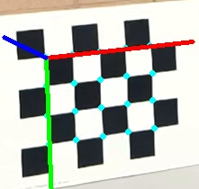

## Participant Recruitment
We collected data from 14 people, who were selected from respondents to a google form sent out to the student body. Five participants had no formal coaching on proper squat form, while 9 participants had received some form of formal coaching, such as from athletics coaches. To follow OSHA safety guidelines, loading was capped at 50lbs. Therefore, to standardize the loading based on bodyweight percentage, no participants above 200lbs were selected for this experiment.
After informing the participants of the risks of the study and obtaining consent, we will collected the the following background information for each participant, which was kept anonymous and confidential:

* Height
* Weight
* Age
* Previous experience with squats
* Previous experience with coaching on squatting form

## Testing
During the testing slot for each participant, they were reminded that their participation was voluntary and that they could stop at any time. The test setup included two tripods 30-45° apart, two iOS-compatible phones with OpenCap, a checkerboard background (for OpenCap calibration) that was 4x5 with 35mm checkers, and tape markings where the person should stand and where each of the tripods was located to ensure consistency. 

<figure class="figure">

<figcaption>Checkerboard background for OpenCap calibration.</figcaption>
</figure>

// Test setup with tripods, board, and tape shown. //

We tested 3 levels of weight (0%, 10%, and 25% of bodyweight) across participants with 5 squats at each weight for a total of 15 squats per person. Before squatting, participants were shown this [video](https://youtu.be/v_c67Omje48?si=mdjvCrdrU22HiMba&t=57) (from 0:57-1:07) to demonstrate the type of squat that they were asked to perform. No other specific coaching on form was given. Following the precedent of similar studies, we had participants follow a standardized warm-up and stretching routine prior to squatting to minimize injury risk (Lorenzetti et al., 2018). Participants followed this [video](https://www.youtube.com/watch?v=kNLCnNHN238) from 0-2:14. 

At the start of a session, the following information was provided to setup a participant in OpenCap: weight, height, age, and specification that the participant was unimpaired. Once the session was finished, the data was automatically uploaded to the cloud, which used x model from OpenCap, which uses the model and that data collected to optimize the best fit for marker positions throughout time and report inverse kinematics and inverse dynamics. More in-depth information on OpenCap processing can be found on the OpenCap website, and in Uhlrich et al., 2023.

Each round of 5 squats was captured together in one OpenCap video. Between rounds, participants took a 2-minute rest to minimize any possible effects of fatigue (Martorelli et al., 2015). For the first round of squatting (0% loading case) the participant put their left hand in the air and then dropped it before starting the squats in order to synchronize the cameras (Mobilize Center, 2022). For the 10% and 25% loading cases, the participants were instructed to hold a handheld weight in front of them while squatting. A new session was started each time a new participant’s data was recorded.  

::: {style="text-align: center;"}

:::

## Data processing
	
A python pipeline was used to process and analyze the data. OpenCap data was pulled off of OpenCap using a batch download script from OpenCap. A function based off of the existing OpenColab notebook pulled the data for the relevant joint angles during each squat at each loading condition for one participant. It removed the first half second of data (noise elimination), plotted the data, and then output a matrix of maximum and minimum relevant joint angles for each squat at each loading condition. This was done for each participant. The scipy and stats python packages were incorporated in custom functions for statistical analysis. 

// Diagram of pipeline: 
Batch download → Max or min angular data pulled out of each participants data → [branch]
 → (top branch) data compared within participants using ANOVA → two-sided t-test if ANOVA significant → p-values reported and plotted in bar form. 
→ (bottom branch) data compared between untrained and trained participants using two-sided t-test → p-values reported and plotted in table form. //

Nine joint angles were analyzed in this study, four of which are duplicates as they were measured on both the right and left side of the body: hip flexion, hip adduction angle (as a proxy for knee valgus angle), hip internal rotation, knee flexion angle (reported as knee angle), and trunk extension angle. These are all angles that are frequently studied in the literature when looking at squats. These angles were analyzed both within participants and between participant groups. 
In the within participant case, each angle’s data (five data points from the five squats) were compared between loading conditions using the ANOVA test. If the test was significant, two sided T-tests were performed between each loading condition (three tests). In the between participant case, each participant’s angle data for a specific loading condition was averaged. Then the average angle per condition from all participants were combined into average angles per condition for the untrained group and the trained group. T-tests were performed between each angle at each loading condition. In both cases, only statistically significant differences are reported due to the vast amount of tests performed. 

